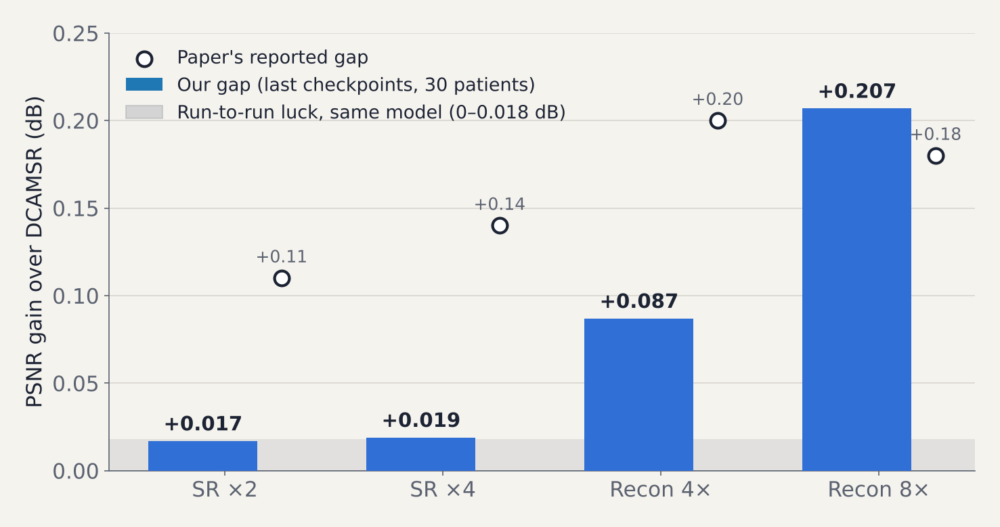
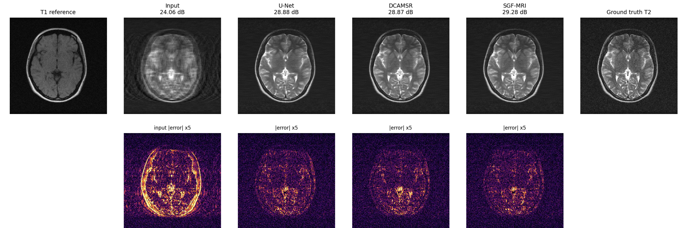

# Implementation of SGF-MRI: Structure Guided Fusion for Multi-Contrast MRI Super-Resolution and Reconstruction

An independent implementation and evaluation of the research paper

> S. Zheng, S. Du, C. Qin, **"SGF-MRI: Structure guided fusion for multi-contrast MRI super-resolution and reconstruction"**, *Pattern Recognition* 180 (2026) 114188.

The authors did not release their code, so I implemented SGF-MRI from the paper's text, equations and figures, reproduced the baseline method DCAMSR from its public code, and evaluated both on the M4Raw brain MRI dataset with per-patient statistical tests.

B.Tech final-year project, Department of Computer Science and Engineering, Indian Institute of Technology (Indian School of Mines) Dhanbad, November 2026.
**Author:** Mahima Sunil Bachhav · **Guide:** Prof. Sushanta Mukhopadhyay

---

## The problem in one paragraph

MRI is slow because the scanner measures k-space line by line. Measuring less is faster but degrades the image. In one session the scanner records several contrasts of the same anatomy: a fast **T1** scan can guide the restoration of a slow, degraded **T2** scan. Two tasks are studied:

- **Super-resolution (SR):** restore a T2 that is 2× or 4× smaller.
- **Reconstruction:** restore a T2 from only 1 in 4 or 1 in 8 k-space columns.

SGF-MRI proposes a **Multi-contrast Structural Distillation (MCSD)** block: it measures neighbourhood similarity within and across contrasts (**MCNS**), weights it with a learned saliency map (**SAN**), and uses the result as the query of a structure-guided attention (**SFA**) that fuses T1 detail into T2.

## Key results



All numbers: M4Raw test set (30 patients, 90 volumes), PSNR in dB / SSIM, last epoch of 50, every comparison tested per patient with a paired Wilcoxon signed-rank test.

### Super-resolution

| Method | SR ×2 | SR ×4 |
| --- | --- | --- |
| Bicubic | 27.36 / 0.672 | 23.62 / 0.434 |
| Multi-contrast U-Net | – | 30.27 / 0.726 |
| DCAMSR (my run) | 32.36 / 0.780 | 30.54 / 0.731 |
| **SGF-MRI (my implementation)** | **32.37 / 0.781** | **30.56 / 0.732** |
| SGF-MRI (paper) | 32.42 / 0.781 | 30.62 / 0.731 |

My SGF-MRI reaches the paper's scores (best epoch 32.44 / 30.61 dB). Its gain over DCAMSR (+0.02 dB) is the size of run-to-run variation, so in SR the two methods are tied.

### Reconstruction

| Method | 4× | 8× |
| --- | --- | --- |
| Zero-filled input | 25.56 / 0.652 | 22.94 / 0.527 |
| Multi-contrast U-Net | 30.13 / 0.784 | 27.93 / 0.699 |
| DCAMSR (my run) | 30.46 / 0.790 | 28.16 / 0.706 |
| **SGF-MRI (my implementation)** | **30.55 / 0.792** | **28.37 / 0.711** |
| SGF-MRI − DCAMSR | +0.087 dB, 29/30 patients, p = 5.6×10⁻⁹ | +0.207 dB, 30/30 patients, p = 1.9×10⁻⁹ |
| SGF-MRI (paper) | 29.82 / 0.716 | 28.27 / 0.666 |

SGF-MRI clearly beats DCAMSR in reconstruction, and at 8× the gain matches the paper's +0.18 dB. (At 4× all my models score about 0.8 dB above the paper; the paper does not describe its undersampling mask, so only comparisons within my pipeline are meaningful there.)



### Ablation (my observations on M4Raw, 16 epochs per version)

| Version | Params | Recon 4× | Recon 8× |
| --- | --- | --- | --- |
| A · MC baseline, no MCSD | 3.92 M | 30.605 | 28.487 |
| B · + intra-contrast similarity | 3.99 M | 30.608 | – |
| C · + cross-contrast similarity | 4.02 M | 30.614 | – |
| D · + saliency = full SGF-MRI | 4.13 M | 30.604 | 28.479 |
| D − A (per patient) | | −0.001 dB, p = 0.73 | −0.008 dB, p = 0.86 |

On M4Raw the structure-guided parts gave no measurable gain. Version A already beats DCAMSR, so SGF-MRI's advantage appears to come from its lighter backbone. The paper's own ablation used fastMRI knee data, which I did not repeat.

### Efficiency (Tesla T4, one 256 × 256 image, both models compiled)

| Model | Parameters | Inference time | GPU memory |
| --- | --- | --- | --- |
| DCAMSR | 9.29 M | 146.6 ms | 248 MB |
| SGF-MRI | 4.13 M | 166.8 ms | 281 MB |

SGF-MRI has 56% fewer parameters but is about 14% slower. The paper's large savings are measured against SGSR, not DCAMSR.

### Summary

| Claim in the paper | Observed here |
| --- | --- |
| SGF-MRI reaches 30.62 / 32.42 dB (SR ×4 / ×2) | Reproduced (30.61 / 32.44, best epoch) |
| Better than DCAMSR in reconstruction | Confirmed (+0.09 dB at 4×, +0.21 dB at 8×) |
| Better than DCAMSR in SR | Not observed (+0.02 dB, a tie) |
| Each structure-guided part adds quality | Not observed on M4Raw |
| About 4 M parameters | Confirmed (4.13 M) |
| Lower inference time and memory | Not observed against DCAMSR |

A seed study (the same U-Net trained three times) showed run-to-run variation of up to 0.018 dB, and that a paired test can call two runs of the same model "highly significant" (p = 2.4×10⁻⁵). Small gains therefore need repeated runs before they can be trusted.

## Repository structure

```
├── notebooks/
│   ├── 01_data_download_preprocess.ipynb      download M4Raw, verify checksums, preprocess as DCAMSR
│   ├── 02a_baselines_bicubic_zerofilled.ipynb bicubic (SR) and zero-filled (reconstruction)
│   ├── 02b_unet_baselines_sr4.ipynb           single- and multi-contrast U-Net, SR ×4
│   ├── 03_dcamsr_super_resolution.ipynb       DCAMSR from its authors' code, SR ×2 / ×4
│   ├── 04_sgfmri_super_resolution.ipynb       SGF-MRI, SR ×2 / ×4, paired tests vs DCAMSR
│   ├── 05_efficiency_speed_memory.ipynb       parameters, inference time, GPU memory
│   ├── 06_reconstruction_4x.ipynb             U-Net, DCAMSR, SGF-MRI at 4×
│   ├── 07_seed_study.ipynb                    run-to-run variation (3 seeds)
│   ├── 08_ablation_reconstruction_4x.ipynb    ablation versions A–D at 4×
│   ├── 09_reconstruction_8x.ipynb             U-Net, DCAMSR, SGF-MRI at 8×
│   ├── 10_ablation_reconstruction_8x.ipynb    ablation versions A and D at 8×
│   └── 11_visual_results.ipynb                example slices, error maps, zoomed crops
├── src/
│   ├── m4raw_prep.py         M4Raw preprocessing (as DCAMSR)
│   ├── m4raw_dataset.py      dataset, SR degradation and undersampling masks
│   ├── models_dcamsr.py      DCAMSR, ported from the authors' repository
│   ├── models_sgfmri.py      SGF-MRI: MCNS, SAN, SFA and the MCSD block
│   ├── sgf_train.py          training, evaluation (PSNR/SSIM), paired tests, profiling
│   └── bench_speed.py        speed and memory benchmark
├── figures/                  result figures
├── requirements.txt
└── README.md
```

Each notebook is self-contained: it writes the modules it needs (the copies in `src/` are the final versions) and runs on Kaggle's free GPUs.

## How to run

1. Create a Kaggle notebook with a GPU (T4 ×2) and internet access enabled.
2. Run `01_data_download_preprocess.ipynb`. It downloads M4Raw v1.6 from its official Hugging Face page, checks every file against the published SHA-256 checksums, and writes the preprocessed data. Save the output as a Kaggle dataset.
3. Attach that dataset to the other notebooks and run them in order. Training notebooks save a checkpoint every epoch and resume automatically, because a 50-epoch DCAMSR or SGF-MRI run (13–15 h) exceeds Kaggle's 12-hour session limit.
4. `11_visual_results.ipynb` needs the trained checkpoints from notebooks 04, 06 and 09 attached as inputs.

To run locally instead: `pip install -r requirements.txt`, then change the `/kaggle/...` paths at the top of each notebook.

## Implementation details

**Training (all models, as stated in the SGF-MRI paper):** L1 loss, Adam with learning rate 2×10⁻⁴, ×0.1 after epoch 40, batch size 4, 50 epochs, mixed precision. DCAMSR's own code uses an effective batch of 32 on 8 GPUs; I used 4 for every model so the comparison follows the paper.

**Data:** M4Raw, T1 reference → T2 target; 128 training / 30 test patients (384 / 90 volume pairs, 6,912 / 1,620 slices). Reconstruction uses a fastMRI-style random column mask with an 8% (4×) or 4% (8×) fully sampled centre.

**Details the paper does not specify.** I made 15 choices and documented each one, for example:

- one encoder shared by T1 and T2 (the only option that matches the paper's "about 4 M" parameters);
- the 8 neighbours are ±1 and ±2 pixels up, down, left and right;
- saliency applied at each neighbour, with a sigmoid output;
- 8 channel groups of 8 channels;
- SFA attention inside local 8×8 windows (full attention over 65,536 pixels would not fit the paper's reported memory);
- similarity computed in float32 under mixed precision.

**Verification:** MCNS and SFA match direct implementations of the paper's equations to within 10⁻⁷; the ported DCAMSR gives outputs identical to the original code.

## Limitations

- One training run per large model; run-to-run variation was measured on the U-Net.
- The 15 unspecified details are my choices; the authors' code would be needed to settle them.
- The paper's reconstruction mask is unknown.
- Ablations used a 16-epoch schedule and M4Raw only; fastMRI knee was not tested.
- Quality measured by PSNR and SSIM only, with no clinical reading.

## Acknowledgements and references

- SGF-MRI: S. Zheng, S. Du, C. Qin, *Pattern Recognition* 180 (2026) 114188.
- DCAMSR: S. Huang et al., "Accurate multi-contrast MRI super-resolution via a dual cross-attention transformer network", MICCAI 2023. Code: [github.com/Solor-pikachu/DCAMSR](https://github.com/Solor-pikachu/DCAMSR). `src/models_dcamsr.py` is ported from this repository (branch SRV1.3, commit f42c64d).
- M4Raw: M. Lyu et al., "M4Raw: A multi-contrast, multi-repetition, multi-channel MRI k-space dataset for low-field MRI research", *Scientific Data*, 2023. Data: [github.com/mylyu/M4Raw](https://github.com/mylyu/M4Raw).
- fastMRI: J. Zbontar et al., "fastMRI: An open dataset and benchmarks for accelerated MRI", arXiv:1811.08839, 2018.

This repository contains no MRI data and no trained weights. The dataset must be downloaded from its official source under its own terms.
